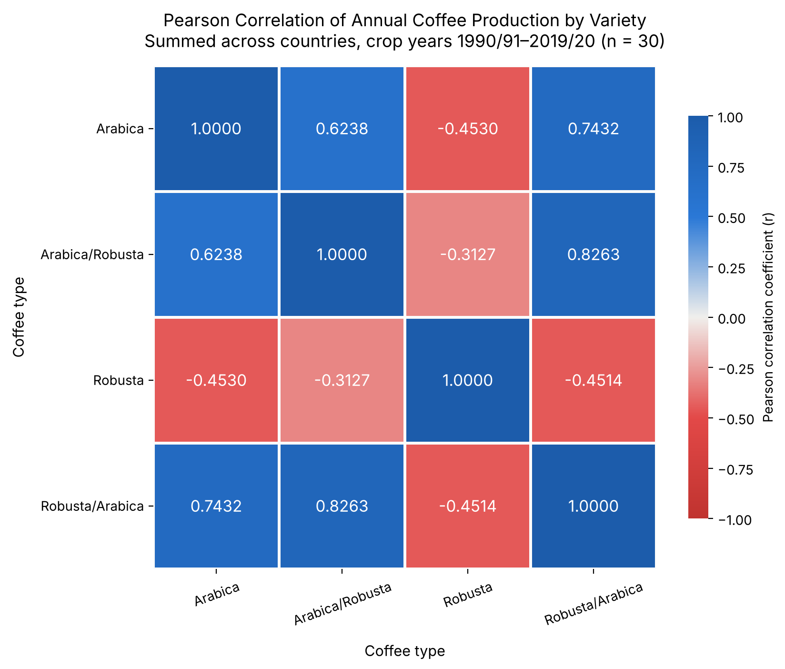

# Global Coffee Production Correlation Analysis

Correlation analysis of global coffee production by variety across **30 crop years
(1990/91 – 2019/20)** using Pandas aggregation, matrix transposition, and Pearson
correlation.



## Key Results

| | Coffee types | Pearson r |
|---|---|---|
| **Strongest positive pair** | Arabica/Robusta & Robusta/Arabica | **0.8263** |
| **Weakest pair (closest to 0)** | Arabica/Robusta & Robusta | **−0.3127** |

Full correlation matrix (rounded to 4 d.p.):

| | Arabica | Arabica/Robusta | Robusta | Robusta/Arabica |
|---|---|---|---|---|
| **Arabica** | 1.0000 | 0.6238 | −0.4530 | 0.7432 |
| **Arabica/Robusta** | 0.6238 | 1.0000 | −0.3127 | 0.8263 |
| **Robusta** | −0.4530 | −0.3127 | 1.0000 | −0.4514 |
| **Robusta/Arabica** | 0.7432 | 0.8263 | −0.4514 | 1.0000 |

The three groups that grew over the period are all positively correlated with one
another. The pure Robusta group, which declined, is negatively correlated with all of
them. The notebook's Statistical Reflection section covers interpretation, caveats,
and the distinction between correlation and causation.

## Dataset

`Coffee_production.csv`: 55 producing countries × 30 crop-year production columns
(`1990/91` … `2019/20`), plus `Country`, `Coffee type` and `Total_production`.

- Each **country** carries one classification: `Arabica`, `Robusta`,
  `Arabica/Robusta` (mainly Arabica), or `Robusta/Arabica` (mainly Robusta).
  The groups are therefore country groups, not species totals. For example, Viet Nam
  is counted under *Robusta/Arabica*.
- The file has no missing values, and `Total_production` equals the sum of the 30
  annual columns for every row (checked in the notebook).
- Units are not stated in the file. Magnitudes are consistent with kilograms.
  Pearson correlation is unit-free.

## Methodology

1. **Load & validate:** strip whitespace, identify the classification column and the 30
   crop-year columns by pattern, rename them to `1990_1991 … 2019_2020`, convert to
   numeric, and check for missing, negative, or inconsistent values.
2. **Aggregate:** `df.groupby("Coffee type")[year_cols].sum()` gives a table with
   coffee types as rows and years as columns.
3. **Transpose:** `.T` makes years the rows (observations) and coffee types the columns
   (variables), which is the layout `DataFrame.corr()` expects.
4. **Correlate:** `.corr(method="pearson")`, after excluding constant or insufficient
   series. The diagonal (= 1.0), symmetry, and agreement with `numpy.corrcoef` are all
   checked.
5. **Rank pairs:** the 6 unique pairs (no self-pairs or mirrored duplicates). Strongest =
   maximum r; weakest = minimum |r|.
6. **Visualize:** annotated diverging heatmap (−1 to +1) and a production trend chart
   (absolute and indexed to 1990/91).
7. **Reflect:** answers to both assignment questions. A code cell asserts that every
   number quoted in the written answers matches the computed results.

## Project Structure

```
.
├── Coffee_production.csv            # dataset (project root, loaded by relative path)
├── coffee_production_analysis.ipynb # executed notebook with all outputs
├── figures/
│   ├── correlation_heatmap.png
│   └── production_trends.png
├── scripts/
│   └── build_notebook.py            # source for the notebook cells
├── pyproject.toml                   # uv project + dependencies
├── uv.lock                          # pinned dependency versions
├── .python-version
├── .gitignore
└── README.md
```

## Setup and Running

Requires [uv](https://docs.astral.sh/uv/) and Python ≥ 3.11.

```bash
git clone https://github.com/Yisakor-Mirany/Coffee-Production-Correlation-Analysis.git
```

```bash
cd Coffee-Production-Correlation-Analysis
```

```bash
uv sync
```

**VS Code:** open `coffee_production_analysis.ipynb`, choose the `.venv` interpreter
as the kernel, then click **Run All**.

**Jupyter in the browser:**

```bash
uv run jupyter notebook coffee_production_analysis.ipynb
```

**Re-execute headlessly from top to bottom:**

```bash
uv run jupyter nbconvert --to notebook --execute --inplace coffee_production_analysis.ipynb
```

`scripts/build_notebook.py` regenerates the notebook *source* (without outputs) from
plain Python. Run it only if you edit the analysis, and re-execute afterwards.

## Tools

Python 3.11+ · uv · pandas · matplotlib · seaborn · Jupyter Notebook
